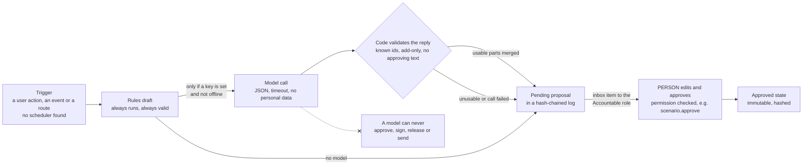
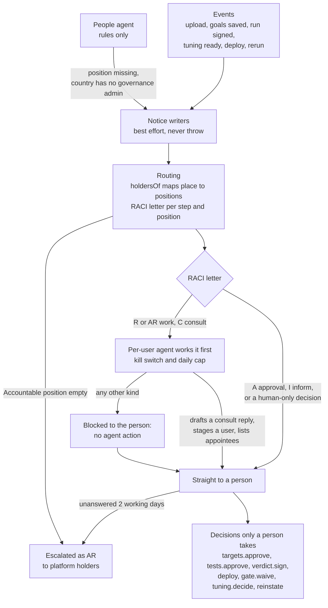

# Agents and orchestration in Prism

Written 2026-11-27 from a read of the code (not from earlier docs), after PR #58. Paths are under `src/`.

This is a snapshot before the generic SOP Pilot was added. The new workflow runs approved Testgen cases using a pinned job-profile skill and tunes supplemental guidance against the same set. UC09's Screening Analyst reached 6 of 6 on a local run with the configured model and simulated Sijil screening. The Pilot score does not issue a release verdict.

**Central finding.** There is no generic agent framework. Every "agent" is a bounded function that is either deterministic, or rules plus an optional model call whose reply is validated by code. Nothing in the code lets a model approve, sign, release or send. Model calls go through `chatCompletion` in `lib/llm.ts`; `agentLlmEndpoint()` in `lib/un/agent-llm.ts` only reroutes the base URL.

## Why nothing is scheduled: the chain starts from the setup, not from a clock

The minimum input for running the whole chain is a completed setup: the country configuration (rules, policy sources, policy target, governance admin), the entity and its goals, the use cases with their process targets, and the SOP. Until a person supplies those there is nothing for any agent to work on, so there is nothing to put on a timer. The country policy sources and the SOP are built into knowledge bases (the country KB; the SOP KB and skills); the goals and targets are logged records the agents read. The starting event of the chain is therefore **the setup completing**, and the code has no scheduler, cron or poller: every agent runs because a person acted, an event fired or a route was called.

What this means for "no further clicks": see the last section, which records what runs by itself today and what still needs a click.

## Figure 1: the pattern every agent follows

A model only ever wraps rules, and its output has to pass code before it becomes a pending proposal that a person decides.

## Figure 2: how work reaches a person

Orchestration is the inbox: events are routed by RACI letter, agents work the "responsible" items first, and every decision goes to a person.

## Figure 3: which component acts at each stage

Each arrow is what must be true to leave a stage, and every stage waits for the one before it.

```mermaid
flowchart LR
  subgraph SETUP["Setup, one page"]
    direction LR
    S1["Country<br/>policy target,<br/>governance admin"] --> S2["Entity goals<br/>and measures"] --> S3["Use cases<br/>upload"] --> S4["Process targets<br/>TARGETS AGENT drafts<br/>person approves"] --> S5["SOP intake<br/>SOP analyzer"]
  end
  S5 --> A1
  subgraph LIFE["Lifecycle, nine stages"]
    direction LR
    A1["1 sop<br/>analyzer, profiles, KB"] -->|"SOP attached, profile ticked, KB ready"| A2["2 gates<br/>rule set, own gates, HITL"]
    A2 -->|"person accepts or waives each gate"| A3["3 verdict<br/>role agents, coordinator,<br/>engine decides"]
    A3 -->|"person signs the run"| A4["4 tests<br/>TESTGEN proposes"]
    A4 -->|"governance admin approves<br/>test set and parameters"| A5["5 pilot<br/>pilot agent, goal judge"]
    A5 -->|"person approves goal judgments"| A6["6 evals<br/>eval runner via Sijil gate"]
    A6 -->|"run meets the bar"| A7["7 tuning<br/>certify, TUNING AGENT"]
    A7 -->|"process owner decides proposals"| A8["8 approval<br/>release gate"]
    A8 -->|"process owner approves version"| A9["9 production<br/>deploy"]
  end
  A9 -->|"a person clicks a window"| W["Watchdog window<br/>re-run evals, warn, suspend"]
  W -->|"reinstate: person after rollback and re-test"| A9
```

## The components

| Component | Kind | Where a model is used | Trigger | Writes | Human gate |
|---|---|---|---|---|---|
| Targets agent (`lib/un/targets-agent.ts`) | Rules, optional model | Rewords statement and evidence only | Upload, goals saved, "draft again" | Pending proposal, `un_target_log` | `scenario.approve` (governance admin) |
| Consult-draft (`consult-draft.ts`) | Rules, optional model | Drafts a reply, no names or emails | Opening the inbox | Draft on the item, `un_agent_log` | Person edits and sends |
| Per-user inbox agent (`inbox-service.ts` `runAgent`) | Deterministic | Only for consult drafts | Inbox open or run | Staged user, candidate lists | Person confirms |
| Role agents and coordinator (`agents.ts`, `round.ts`) | Rules, optional model (`llm: true`) | Add-only messages citing known ids | Person stages or releases a step | Run plus hash-chained signature | `run.sign` (process owner) |
| SOP analyzer (`sop/reference.ts`, `sop/llm.ts`) | Rules, optional model | Fills a missing actor or system from source lines | Analyze route (`use_model`) | Promoted use case | Person uploads and promotes |
| Pilot agent, ReAct (`analyst-agent.ts`, `react-*.ts`) | Deterministic by default | Optional reasoner, reflector, fee-notice drafter | Pilot, eval, watchdog routes | Case memory, outside queue | T15 to T18 human only; person releases notices |
| Goal judge (`goal-judge.ts`) | Model | Judges tests against goals; a failed call is "unjudged", never a pass | "judge" on the pilot goals route | `un_goal_review_log` | `goals.approve` (process owner) |
| Testgen (`testgen.ts`) | Model, deliberately a different one | Proposes cases, real citations required | "generate" act | Generation log | Each case, then `scenario.approve` |
| Tuning agent (`auto-tune.ts`, `autotune-service.ts`) | Rules plus model edits | Up to 3 misses per iteration | A person's action | `un_autotune_log`, versions | `tuning.decide`; auto-applies only if low risk, no regression and held-out below 0.95 |
| Tuning and certification (`tuning.ts`) | Deterministic | None | `tuning.run` | `un_tuning_log`, `un_eval_runs` | `tuning.approve` |
| People agent (`people-agent.ts`) | Deterministic | None | Inbox refresh, role changes | Inbox items | Person appoints |
| Watchdog (`watchdog.ts`) | Deterministic, simulated | None | A person clicks a window | `un_watchdog_log` | Reinstatement by a person |

Gates, HITL, the release gate, Sijil and the pilot arithmetic are deterministic checks, not agents. Sijil and the watchdog's served agent are simulated.

Hash-chained logs: `un_tuning_log`, `un_autotune_log`, `un_watchdog_log`, `un_goal_review_log`, `un_gate_log`, `un_target_log`, `un_test_set_log`, `un_verdict_param_log`, the testgen generation log, the case memory, run signatures and the Sijil seal.

## Not confirmed by the code read
- Whether `un_agent_log` is itself hash-chained.
- Which permission the pilot POST route enforces.
- The table names of the testgen and case-memory logs.
- Whether an external scheduler exists (only `.github/workflows/ci.yml` was found; no `vercel.json`, cron or `setInterval`).

## Autonomy today: does the chain run by itself after the setup?

**Result: no. After the setup, the chain does not run by itself.** Checked on an offline copy of the app with UC09 of the Sahel Federal Workforce Agency, with the entity goals measured, UC09's targets approved and an SOP attached (the front end was read page by page; the actions a person would click were called through the same routes).

What was observed:
- UC09's own page says "Release blocked: fix 1 thing: no job profile is ticked to be automated", while the dashboard strip says "Setup complete". The two disagree because the "Automate" tick is not part of the setup.
- With no clicks for 45 seconds (and again for 30), no table changed and the page was identical. Nothing advanced.
- Ticking a profile worked, but the answer said `no knowledge base for this SOP: run node scripts/build_sop_kb.ts` and wrote no skill. The next step then read "Fix on Pilot: no pilot has been run", with a "Run the pilot" button.
- The tests, evals, tuning and production pages offered no controls at all.

What is missing, in the order it would block a no-click run:

1. **The automation tick sits outside the setup.** BUILT (2026-11-27, branch `fix/uc09-e2e-gaps`): the last part of setup step 5 lists each use case's derived job profiles with an Automate checkbox, shows each profile's risk flags in words, and a person confirms (nothing is pre-ticked: a derived profile carries no automation suggestion, and a role that approves or decides should stay human). Step 5 is now done only when each use case's SOP stage is ready (SOP attached, knowledge base ready, a profile ticked, a skill built), not when an SOP is merely attached.
2. **An uploaded SOP did not become a knowledge base or skills from the front end.** BUILT (same branch): attaching an SOP, a new version or a profile edit chunks and embeds it inside the app and stores it in the knowledge-base store (`lib/un/sop-kb-live.ts`; the database when hosted, a file offline). `loadAttachedSop` makes the stored knowledge base available to every reader of `loadSop`, ticking a profile builds it if it is missing, stale for the version or built without vectors, and the skill is assembled from the stored chunks (nothing written to disk; only its hash is recorded). The rule that an automated agent is refused an SOP without current vectors is kept: a build that cannot embed says so and the SOP stays not ready. Verified offline end to end, including after a cold restart. Not run against hosted: the embedder must load where the app runs (it does on the dev server; on a serverless host it is unproven, and the build reports it plainly when it cannot).
3. **Nothing drives the chain.** Each machine step waits for a click: run the scenario, generate tests, run the pilot, judge goals, run evals, run a tuning cycle, deploy, run a watchdog window. None of these needs human judgment.
4. **The stage order is only a display rule.** The pilot page offers "Run the pilot" although the earlier stages are not done.

What should stay a human decision (HITL): accepting or waiving a gate, signing the verdict run, approving the test set and parameters, approving goal judgments, deciding tuning proposals, approving the version, deploying, and reinstating after a suspension. Everything else is machine work.

Proposed, not built: an event-driven driver. The start event is the setup completing (no clock). When the setup completes, or when any approval lands, the driver runs the next machine step and raises the next approval in the inbox, so a person is only asked when a decision is needed. It needs items 1 to 4 above first.

## The limit that comes after the setup: the pilot, evals and tuning exist only for UC02

Found while building items 1 and 2 (2026-11-27). Even with the setup complete, the knowledge base built and a profile ticked, a use case on any other SOP stops at the pilot:

- `POST /use-cases/[id]/pilot` answers `409 The real agent has executable cases only for SOP-LIC-014` for any other SOP (the route compares against the constant `SOP_ID`).
- `ROLE_OF_PROFILE` (`lib/un/testgen.ts`) maps only UC02's profile names (Document Verification Analyst, Fee and Payment Officer, Licensing Front-Desk Officer, ...) to agent roles; any other profile is refused with 422.
- The executable cases, the recorded OCR and the agent itself (`analyst-agent.ts`, `task-evals.ts`, `doc-ocr.ts`, `fixtures-uc02.ts`) are the licence-renewal agent.
- `evalSetFor(extId)` returns an empty list for a use case without a hand-written eval set, so the evals stage cannot be met; the tuning bank and the "real agent" evals on the tuning page are UC02 only; the watchdog re-runs the same eval set.

So for UC09 the chain can be run up to the tests stage. A generic, SOP-driven agent executor and generated eval sets are a separate and much larger piece of work than the setup, the knowledge base or the driver.

## The limit that comes before the pilot: a verdict needs a scripted scenario, and only three use cases have one

Found while preparing the driver (2026-11-27). The first stages after the SOP cannot complete for a use case that has no staged scenario:

- A verdict is produced only by `POST /runs { scenario_id }`, and `SCENARIOS` holds four fixed, hand-written scripts: S1 (UC02), S2 (UC01), S3 (the 20-use-case portfolio) and S4 (UC13). There is no route to run a scenario for any other use case.
- Each scenario is a narrative: a sequence of steps (T0 to T5), each with events written as sentences (for example "Hosting report: the voice and model endpoints are on DESC-certified infrastructure", "Sijil alert: hallucination rate 6.1%") tagged with a role, a gate and a status (pass, fail, fix_declared), and an expected verdict per step. They illustrate the engine; they are not evidence about a real system.
- Stage 2 (gates) is accepted from the use case's SIGNED VERDICT RUN (`journey-gates.ts` `gateAcceptance`, `uc.verdict_run_id`). With no run there are no gate results, so gates can never be accepted, and stage 3 (verdict) can never be signed.

So for UC09 the road ends at stage 2, right after the SOP stage, and no front-end action can move it. The pilot, evals and tuning limits above sit behind that.

What a real use case would need is a way for the entity to supply EVIDENCE for each gate (documents or attestations), for the role agents to assess it against the knowledge bases, for the engine to decide, and for a person to sign. Writing a scripted scenario for it would mean inventing evidence, which should not be presented as real.
